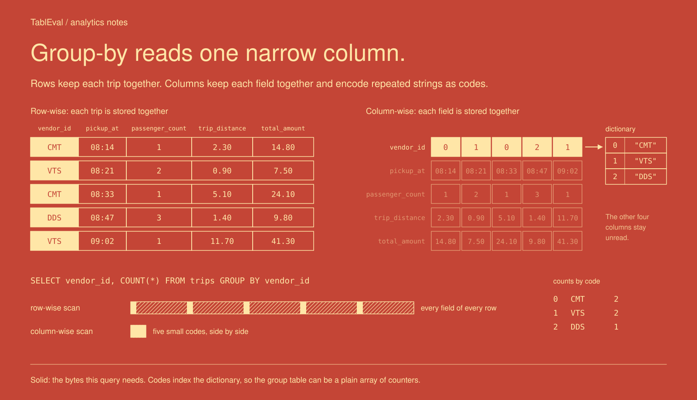
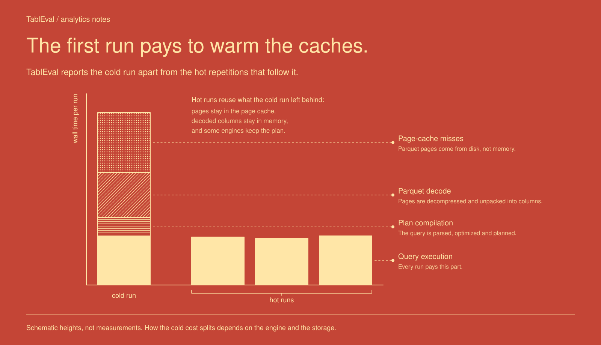
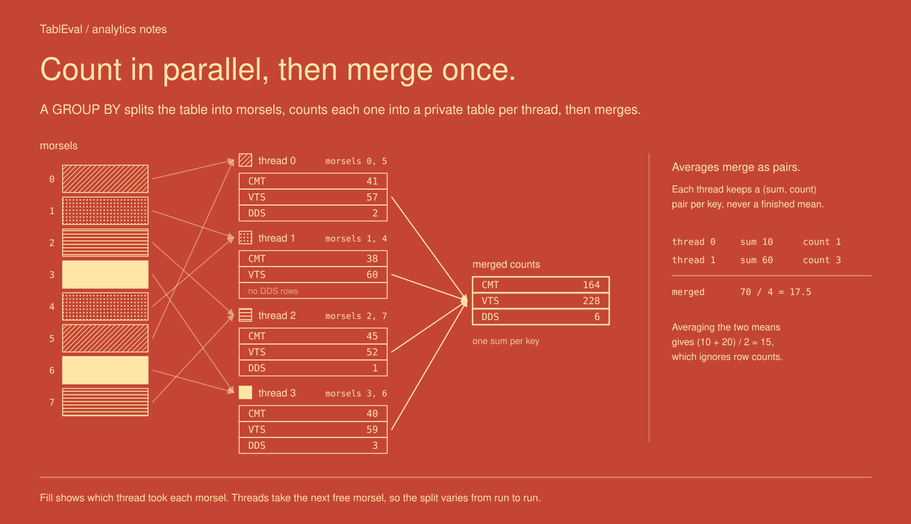

# TablEval


__TablEval__ benchmarks tabular analytics: scans, filters, group-bys, joins and sorts over billions of rows.
It is the Rust successor to UDSB and a sibling of [RetriEval](https://github.com/ashvardanian/RetriEval) and [CrudEval](https://github.com/ashvardanian/CrudEval).
One shared runner drives embedded query engines, a hand-written Arrow baseline, database servers and GPU dataframes over the same Parquet parts.
Runs load the tables once, time every query cold and then hot, verify each answer, and write timings, resource usage and configuration to JSON.

## Quick Start

```sh
sudo apt-get install build-essential clang cmake pkg-config
cargo run --release --no-default-features --features generate --bin tabl-generate -- \
    --scale-factor 1 --output data/tpch-sf1
cargo run --release --bin tabl-eval-duckdb -- \
    --dataset data/tpch-sf1 --threads 1,8 --source loaded,parquet --output results/
uv run scripts/plot.py results/ --output plots/
```

DuckDB is the default Cargo feature.
Every other binary has its own `<engine>-backend` feature; engine code is compiled only when selected.
Server binaries require a running Docker daemon and pull a pinned image on first use.
They publish a random port on localhost, mount the dataset folder read-only, wait for a successful query, and remove their containers when the run ends.

```sh
cargo run --release --no-default-features --features datafusion-backend \
    --bin tabl-eval-datafusion -- --dataset data/taxi --rows 10M,100M,1G
cargo run --release --no-default-features --features clickhouse-backend \
    --bin tabl-eval-clickhouse -- --dataset data/clickbench-100m --source loaded,parquet
```

## Backends

| Backend                                    | Parallelism                  | Sources           | Taxi | TPC-H         | ClickBench |
| :----------------------------------------- | :--------------------------- | :---------------- | :--: | :-----------: | :--------: |
| `tabl-eval-duckdb`, DuckDB bundled         | `SET threads`                | loaded, parquet   |  ✓   |       ✓       |     ✓      |
| `tabl-eval-datafusion`, DataFusion 55      | `target_partitions`, Tokio   | loaded, parquet   |  ✓   |       ✓       |     ✓      |
| `tabl-eval-polars`, Polars 0.55 SQL        | `POLARS_MAX_THREADS`         | loaded, parquet   |  ✓   |      ✓ ¹      |    ✓ ¹     |
| `tabl-eval-sqlite`, SQLite bundled         | one thread                   | loaded            |  ✓   |       ✓       |    ✓ ²     |
| `tabl-eval-arrow`, arrow-rs 60 by hand     | ForkUnion                    | loaded            |  ✓   |  Q1 and Q6    |            |
| `tabl-eval-clickhouse`, ClickHouse 25.8    | `max_threads`                | loaded, parquet   |  ✓   |       ✓       |     ✓      |
| `tabl-eval-postgres`, PostgreSQL 18.6      | parallel workers per gather  | loaded            |  ✓   |       ✓       |     ✓      |
| `tabl-eval-cudf`, cuDF through `cudf` 0.3  | one GPU                      | loaded            |  ✓   |  Q1 and Q6    |            |

> ¹ Queries Polars' SQL frontend cannot parse or plan are reported as `unsupported` rather than ported to its lazy API.
> ² SQLite has no `REGEXP_REPLACE` or `DATE_TRUNC`, so the ClickBench queries using them are reported as `unsupported`.

The table describes what each adapter attempts; every report lists the queries an engine could not run.
`loaded` ingests the parts into the engine's own storage before the queries: a DuckDB database file, DataFusion `MemTable`s, collected Polars frames, SQLite and PostgreSQL tables, ClickHouse MergeTree tables, decoded Arrow batches, or cuDF device tables.
`parquet` registers views over the parts, so every query decodes them again.
Each engine keeps its own thread pool, sized by `--threads`; only the Arrow baseline splits work itself, evenly across a ForkUnion pool.
Polars sizes one global pool when it first runs, so `tabl-eval-polars` takes one `--threads` value per process.

SQLite stores dates and timestamps as ISO text and rewrites three spellings of the shared SQL: date casts, `EXTRACT(YEAR …)` and `SUBSTRING(… FROM … FOR …)`.
ClickHouse runs with `join_use_nulls` on, the standard SQL semantics for outer joins, and reads the parts through its `file` table function.
PostgreSQL ingests through `COPY` into unlogged tables and keeps dynamic shared memory in `mmap`ed files, since parallel hash joins outgrow a container's 64 MB `/dev/shm`.
cuDF's group-by leaves out rows with null keys, where SQL keeps them as a group, so a dataset with null keys reports a mismatch there.
It loads decimals as `Float64`, as SQLite and PostgreSQL store them, and filters TPC-H dates by year and day of the year.
The `cudf` crate's C++ bridge builds against libcudf 26.04, and against 26.10 with fixes not yet released, which a `[patch.crates-io]` entry in `.cargo/config.toml` can point at.
Its build reads `CUDF_ROOT`, the libcudf prefix such as the `libcudf` folder of the `libcudf-cu13` wheel, and `CUDA_PATH`, and links Arrow from a `pyarrow` installed beside it.
The binary finds libcudf, RMM, KvikIO, nvCOMP, the RAPIDS logger and Arrow through `LD_LIBRARY_PATH`.

## Queries

Names spell out what a query computes where no standard numbering exists.
The four Taxi queries are the classic billion-taxi-rides set that UDSB ran:

| UDSB      | Query                                   | Computes                                                     |
| :-------- | :-------------------------------------- | :----------------------------------------------------------- |
| Query 1   | `count-by-vendor`                       | Trips per vendor                                             |
| Query 2   | `average-amount-by-passengers`          | Average fare per passenger count                             |
| Query 3   | `count-by-passengers-and-year`          | Trips per passenger count and pickup year                    |
| Query 4   | `count-by-passengers-year-and-distance` | Trips per passenger count, year and whole mile, ranked by year and count |

The distance is floored, where UDSB rounded it.
Engines round halves differently: DuckDB, SQLite and DataFusion round 2.5 to 3, while PostgreSQL and others round it to the even 2, and taxi distances end in `.5` often enough to change the answer.
Every engine floors alike.

TPC-H runs its 22 queries, `q01` through `q22`, with the specification's validation parameters, as written in DuckDB's `tpch` extension.
ClickBench runs its 43 queries, `q00` through `q42`, in their PostgreSQL spelling.
`--queries q01,q06` selects and orders a subset.

## Datasets

The datasets and their download or generation recipes are in [`data/README.md`](data/README.md).

| Dataset       | Fact Table | Rows     | Other Tables | Source                                    | Answers Pinned       |
| :------------ | :--------- | -------: | -----------: | :---------------------------------------- | :------------------- |
| NYC Taxi      | `trips`    |    1.78G |            0 | TLC yellow trips, 2009–2024, 31 GB         | four-trip fixture    |
| TPC-H         | `lineitem` | 6M × SF  |            7 | generated by `tabl-generate`               | at SF 0.01 and 1     |
| ClickBench    | `hits`     |     100M |            0 | ClickBench's partitioned set, 14.7 GB      | none, cross-checked  |

`--rows 100M,1G` sweeps prefixes of the Taxi and ClickBench fact tables in whole parts.
TPC-H scales by folder, `data/tpch-sf10` or `data/tpch-sf100`, instead.

## Results

Each run reports a cold and several hot times per query, so tables built from them follow one methodology:

- `Device`: the cores or GPU a run used, like `128× Intel Xeon6` for physical cores or `148× NVIDIA SM103` for one B300.
- `Source`: `loaded` or `parquet`.
- `Load`: the wall time to ingest the fact table and the rest; `parquet` runs only register views.
- Per-query columns hold the fastest hot run, in seconds; TPC-H and ClickBench tables give the geometric mean of the completed queries and the count of unsupported ones instead of 22 or 43 columns.
- `Memory`: the peak client RSS plus the server container's peak memory.

Compare engines on the same dataset, row prefix, thread count and source, and only over queries that completed with matching answers.



## CLI Reference

Every binary takes the shared flags; the engine flags apply only to the binary named.
A value spelled `<…,...>` takes comma-separated values and runs one configuration per combination.
Each run prints every setting at the start, as `- Name: value` in the same grammar the flag reads.
A bad value prints `--flag="value" does not parse, expected …` and exits with status 1.
Every flag also reads `TABLEVAL_<FLAG>` as its default, upper-cased with dashes as underscores, so `--time-limit` reads `TABLEVAL_TIME_LIMIT`.

<details>
<summary>Shared by every <code>tabl-eval-*</code> binary</summary>

```text
tabl-eval-*
  --dataset <DIR>                       required
      Folder of <table>.part_NNN.parquet files; its tables pick the suite.
  --rows <N,...>                        all
      Fact-table prefixes in whole parts, with decimal K, M, G or T; a sweep.
  --threads <N,...>                     0
      Engine threads, 0 for all cores; a sweep.
  --source <SOURCE,...>                 loaded
      loaded ingests the parts first, parquet queries them in place; a sweep.
  --queries <NAME,...>                  the whole suite
      Query names, run in the order given.
  --repetitions <N>                     3
      Hot runs after each cold run, 0 for the cold run alone.
  --time-limit <DURATION>               none
      A cold run slower than this, like 60s, skips its hot runs; running queries are never interrupted.
  --verify <LEVEL>                      answers
      answers checks result digests, none skips them.
  --data-dir <DIR>                      data
      Parent of the engines' own storage, one folder per configuration, replaced on every run.
  --output <DIR>                        results
      Directory for JSON reports.
  --perf-counters                       off
      Record system-wide hardware counters per phase; Linux and the perf-counters feature only.
  --drop-caches                         off
      Sync and drop the host page cache before each cold run; Linux as root only.
```

</details>

<details>
<summary>Engine flags</summary>

```text
tabl-eval-duckdb
  --memory-limit <LIMIT>                80%
      Memory DuckDB may use before it spills, as a share or a size like 64GB.

tabl-eval-sqlite
  --cache-size <SIZE>                   1GB
      Page cache size.

tabl-eval-postgres
  --shared-buffers <SIZE>               4GB
      Shared buffer pool, in PostgreSQL's spelling.

tabl-eval-clickhouse, tabl-eval-postgres
  --startup-time-limit <DURATION>       120s
      Time limit for container start and readiness.
```

</details>

<details>
<summary>Data tools</summary>

```text
tabl-generate
  --scale-factor <SCALE>                required
      TPC-H scale factor; 0.01 and 1 have pinned answers.
  --output <DIR>                        data/tpch-sf<SCALE>
      Destination folder.
  --threads <N>                         0
      Generator threads, 0 for all cores.

tabl-download
  --dataset <DATASET>                   required
      taxi or clickbench.
  --output <DIR>                        data/taxi or data/clickbench-100m
      Destination folder.
  --from <YYYY-MM>, --to <YYYY-MM>      2009-01, 2024-12
      Taxi months to fetch.
  --part-rows <N>                       10M
      Rows per Taxi part.
  --keep-raw                            off
      Keep the original files under raw/.
```

</details>

## Output Format

Reports are rewritten atomically after the load and after every query, one `<backend>-<config-hash>.json` per configuration.
They contain the machine, the dataset's tables with their parts, rows and bytes, the requested configuration, and the engine's metadata and applied settings.
The load phase records its status, wall time, fact-table rows per second, sampled client CPU, memory and I/O, the same for the server, and the engine's disk usage.
Servers are sampled through their container's cgroup v2 counters every 100 ms; where the host cannot reach the cgroup, as with Docker Desktop, a `docker stats` snapshot after the phase stands in.
Each query records its status, cold and hot seconds, result rows, digest, whether a pinned answer was checked, and the same resource figures over all its runs.
Statuses are `completed`, `unsupported`, `failed`, `timed-out` and `mismatch`; any `failed` or `mismatch` ends the run with a nonzero status after the remaining queries.

```sh
uv run scripts/plot.py results/ --output plots/ --baseline duckdb
```

The plotting script draws load throughput, per-query hot times, speedups over the baseline across `--rows`, and memory, as SVG in the same red palette as the diagrams here; see [`scripts/README.md`](scripts/README.md).

## Project Layout

```text
Cargo.toml                 Feature-gated backend binaries
src/bench.rs               Library root, CLI, sweeps, load and query phases
src/backend.rs             Backend contract, tables, sources
src/suite.rs               Query catalogs, dataset discovery, pinned answers
src/answer.rs              Canonical answers and digests
src/measure.rs             Process resource sampling
src/output.rs              Reports and atomic output
src/perf_counters.rs       Optional system-wide hardware counters
src/docker.rs              Owned container lifecycle
src/rows.rs                Parquet parts as rows for SQL ingest
src/fixture.rs             Four-trip Taxi fixture for tests
src/<engine>.rs            One binary per engine
src/generate.rs            TPC-H generator
scripts/download.rs        Taxi and ClickBench downloader
scripts/plot.py            Report visualization
sql/                       Taxi and TPC-H queries, pinned TPC-H answers
```

Directory guides describe [source contracts](src/README.md), [datasets](data/README.md), [plotting and checks](scripts/README.md), [standalone server configurations](docker/README.md), and [the TPC-H queries' origin](sql/tpch/README.md).

## Development

The repository pins Rust 1.100, as `beta-2026-10-18` until its stable release.
CI runs `cargo fmt --check`, Ruff on the plotting script, then `cargo clippy` and `cargo test` per feature group; a manually dispatched workflow checks cuDF on a CUDA worker.
Every backend's tests load the four-trip Taxi fixture and, with the `generate` feature, TPC-H at scale 0.01 generated in-process, and check each query the backend supports against the pinned answers.
The Arrow baseline and the generator depend on ForkUnion 4, which a local `.cargo/config.toml` may point at a sibling checkout until it is published.
Arm the hooks once per clone with `git config core.hooksPath .githooks`.
Run `scripts/check-servers.sh` for the managed server checks.

## Remaining Scope

The backend table above describes current support, not every engine considered.
Sirius, DuckDB's GPU extension over libcudf, waits until DuckDB publishes it as a loadable extension.
chDB, StarRocks, Doris, Velox through Gluten, Turso and UStore remain later candidates, with no adapters or placeholder binaries in this crate.

The following planned capabilities remain incomplete:

- Answers pinned for Taxi and ClickBench beyond agreement between engines.

## Benchmark Pitfalls

### Cold vs Hot

The cold run is the first execution after the load, not a cold machine.
It pays for planning, first-touch allocation and, for `parquet` sources, decoding the parts, but the load usually leaves them in the page cache.
`--drop-caches` empties the host page cache before every cold run, so `parquet` sources read the parts from the device; it affects the whole host and needs root.
Hot runs reuse whatever the engine caches, from decoded columns to compiled plans, so the gap between cold and hot measures the engine as much as the query.



### Load vs Query

`loaded` and `parquet` answer different questions: one pays to ingest once and then queries its own format, the other decodes Parquet every time.
An engine that loads slowly but queries fast wins only when the data is queried often enough, so compare load seconds and query seconds side by side.
Row stores such as SQLite and PostgreSQL ingest row by row through SQL, and their load time includes that conversion.

### Result Materialization

Every timed run ends with the full result on the client: Arrow batches, a frame, rows or a JSON body.
Large results, such as TPC-H Q16 at scale 100, therefore include transfer and decoding, especially for servers.
Reducing the result to its digest happens after the timer stops.

### Parallel Aggregation

Every group-by splits the input into morsels, aggregates each into a per-thread table and merges them.
Averages merge as sums and counts, never as averages of averages, which UDSB's batched runner got wrong.



### Global Thread Pools

Some engines size their pools once per process: Polars reads `POLARS_MAX_THREADS` at first use, and Tokio runtimes stay at the size they started with.
TablEval opens a fresh engine per configuration, but sweeps over `--threads` in one Polars process are rejected rather than silently ignored.

## History

UDSB, the Unopinionated Data Science Benchmark, compared Python data-science packages with their multi-threaded and GPU drop-in replacements: NumPy against CuPy for matrices, NetworkX against cuGraph for graphs, and Pandas against Modin, cuDF, Dask and SQLite for tables.
TablEval keeps its tabular half, the four Taxi queries, and rebuilds it in Rust around engines rather than Python wrappers.
The matrix and graph benchmarks were dropped, so the suite stays about tables.
UDSB's published charts were measured on the Python implementation and are not results of this one.
